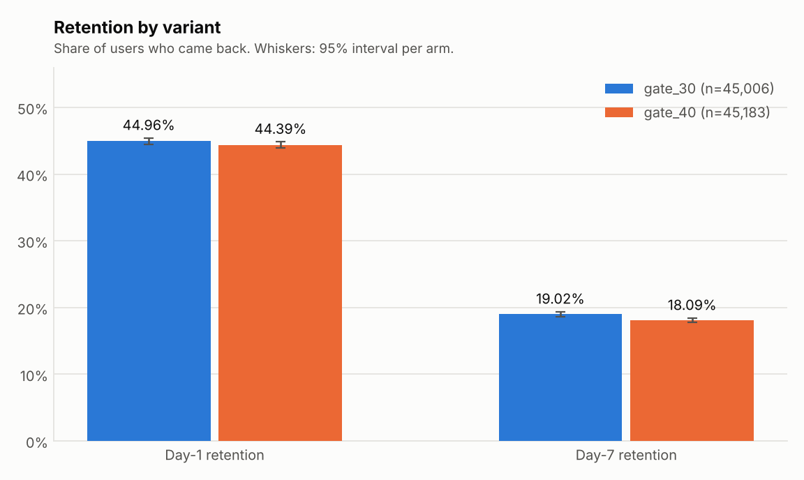
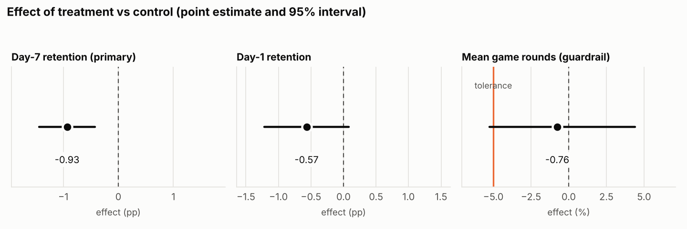
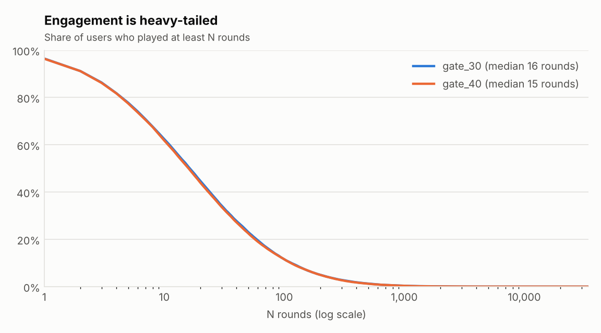
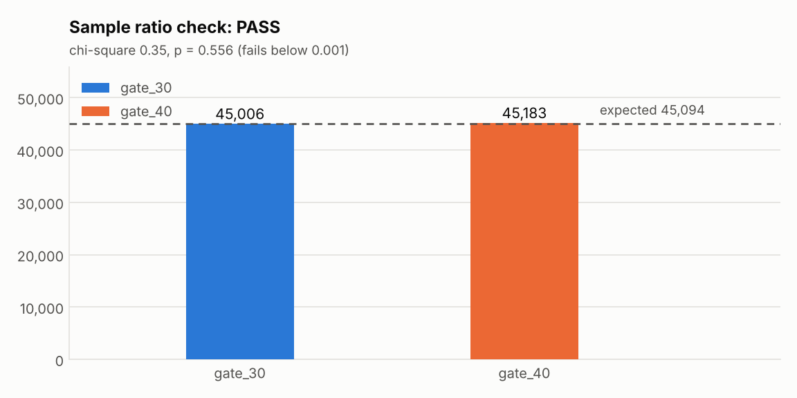
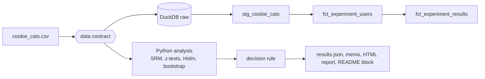

# Experiment analytics: should the first gate move from level 30 to level 40?

A mobile-game team wants to move a progression gate from level 30 to level 40, betting that players who
hit the wall later stay longer. This repository answers the question the way an analytics team should:
check that the experiment is valid, test the metrics without inflating the false-positive rate, make sure
the "win" is not bought by hurting engagement, and end in one of five decisions instead of a p-value.

> **Data status: synthetic.** The bundled dataset is generated to match the schema and the headline
> statistics of the public *Cookie Cats* dataset. The numbers below describe that synthetic data, not the
> real game. The pipeline runs on the real file unchanged; see [Use the real data](#use-the-real-data).

## Result

<!-- RESULTS:START -->
**Data: SYNTHETIC** (90,189 users, source `cookie_cats.csv`)

**Decision: DO_NOT_SHIP** - The treatment significantly lowers the primary metric.

| Metric | gate_30 | gate_40 | Difference | 95% interval | p (Holm) |
|---|---|---|---|---|---|
| Day-1 retention | 44.96% | 44.39% | -0.57 pp | -1.22 pp to +0.08 pp | 0.086 |
| Day-7 retention (primary) | 19.02% | 18.09% | -0.93 pp | -1.44 pp to -0.42 pp | 6.5e-04 |

Sample ratio check passed (p = 0.556). Engagement guardrail NOT cleared: mean game rounds -0.76% (95% interval -5.25% to +4.39%).
<!-- RESULTS:END -->

The block above is generated from `reports/results.json` by `make readme`, and `make readme-check`
(also run in CI) fails if it is stale. Nothing in it is typed by hand.

| | |
|---|---|
|  |  |
|  |  |

Full outputs: [`reports/decision_memo.md`](reports/decision_memo.md) (one page for a product owner) and
`reports/ab_report.html` (self-contained report with figures and method notes).

## What is in here

| Layer | What it does | Where |
|---|---|---|
| Data contract | Rejects files with duplicate users, negative rounds, a third arm, nulls, non-boolean flags | [`docs/data_contract.md`](docs/data_contract.md), `src/abtest/data.py` |
| Validity check | Sample-ratio mismatch via chi-square at alpha 0.001 | [ADR-001](docs/adr/001-srm-threshold.md) |
| Inference | Two-proportion z-tests (pooled SE for p, unpooled for the interval), Holm correction across metrics | `src/abtest/stats.py` |
| Guardrail | Bootstrap non-inferiority test on mean rounds, tolerance -5% | [ADR-003](docs/adr/003-bootstrap-for-rounds.md) |
| Decision rule | `INVALID`, `INCONCLUSIVE`, `DO_NOT_SHIP`, `HOLD` or `SHIP`, in a fixed order | [ADR-002](docs/adr/002-decision-rule.md) |
| Warehouse | dbt + DuckDB: staging view, user-grain and variant-grain marts, schema and singular tests | `dbt_project/` |
| Metric definitions | One definition per metric, roles stated | [`docs/metrics.md`](docs/metrics.md) |



## Quickstart

Requires Python 3.10 or newer.

```bash
git clone https://github.com/qasimrazamalik-coder/ab-testing-analytics ab-testing-analytics && cd ab-testing-analytics
make setup                 # creates .venv and installs requirements.txt
source .venv/bin/activate
make data                  # writes the labelled synthetic dataset (seed 42)
make run                   # validate -> analyse -> charts, HTML report, decision memo
make test                  # 57 unit tests, standard library only
```

Run the warehouse layer (needs the dbt and DuckDB packages from `requirements.txt`):

```bash
make dbt-build             # loads DuckDB, then runs dbt models and all dbt tests
```

Other targets: `make lint`, `make verify` (lint + tests + README check), `make readme`, `make clean`.
Try the validity guard: `python -m abtest.cli generate --out /tmp/broken.csv --srm-break` followed by an
`analyze` run on it produces an `INVALID` verdict.

## Use the real data

1. Download the *Cookie Cats* dataset from Kaggle (search for "Cookie Cats mobile games A/B testing")
   and save the CSV as `data/raw/cookie_cats.csv`. Columns must be `userid, version, sum_gamerounds,
   retention_1, retention_7`.
2. `make run PROV=real`
3. `make readme` and commit the new report. The provenance banner switches to **REAL** everywhere.

If the file breaks the contract the run stops with exit code 2 and says which rule failed.

## What has been verified, and what has not

This was built in an environment that could not install packages from PyPI or reach Kaggle. The table
separates what was run from what was only written.

| Component | Status | Evidence |
|---|---|---|
| Statistical engine (z-test, SRM, Holm, power, bootstrap) | Verified | Hand-computed expected values; Monte-Carlo power check; A/A false-positive rate near 5% |
| Data contract | Verified | 9 violation cases each raise `DataContractError` |
| Decision rule | Verified | All five verdicts and the boundary cases, in `tests/test_pipeline.py` |
| Test suite strength | Verified | 6 deliberate bugs injected into a copy of the code (wrong SE, SRM threshold, skipped SRM, `>=` vs `>`, no duplicate check, no negative check); every one is caught |
| Report, memo, charts | Verified | Generated and the PNGs inspected |
| dbt model **logic** | Verified | The SQL is executed on SQLite and compared with pandas (`tests/test_sql_parity.py`), including singular tests fed data they must reject |
| dbt **wiring** on DuckDB (`dbt build`) | **Not run** | dbt and DuckDB could not be installed here. First run is on the author's laptop |
| GitHub Actions workflow | **Not run** | Written, never executed |
| Real Cookie Cats numbers | **Not run** | Kaggle unreachable here; every number above is from synthetic data |

## Limitations

- The synthetic effect sizes are chosen by the generator, so the verdict demonstrates the pipeline, not a
  finding about any game.
- One look at a fixed sample. Peeking at interim results would need sequential methods (see ADR-002).
- Retention is measured per user and users are assumed independent. Clustered assignment (by household,
  device or region) would call for a clustered variance estimate.
- The bootstrap interval carries Monte Carlo error of about 0.07 percentage points at the default 5,000
  resamples (ADR-003).

## Roadmap

- [ ] First `dbt build` on DuckDB, then wire the green run into CI
- [ ] Re-run on the real Cookie Cats file and replace the synthetic results block
- [ ] Segment cuts (new vs returning payers) with a pre-declared list, to avoid forking paths
- [ ] Sequential testing variant with an alpha-spending boundary
- [ ] Stakeholder dashboard on top of `fct_experiment_results`

## Project layout

```
src/abtest/        stats, data contract, pipeline, report rendering, CLI
dbt_project/       staging + marts models, schema tests, singular tests
tests/             unittest suite (stats, data, pipeline, SQL parity, README sync)
docs/              metrics, data contract, ADRs, generated figures
reports/           results.json, decision memo, HTML report (generated)
scripts/           DuckDB loader
```

Licence: MIT.
